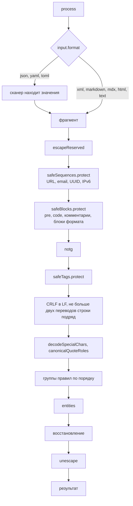

# Архитектура microtypo

Внутреннее устройство движка для контрибьюторов: модули, конвейер, инварианты. Использование — в [readme](../readme.md) и [api/](../api/configuration.md).

## Граница

Движок — чистое преобразование: строка и конфиг на входе, строка на выходе. Внешние эффекты — `performance.now()` для бюджета времени и `crypto.getRandomValues()` для nonce заполнителей. Файлы и потоки есть только у CLI. Зависимостей нет, один `src/` работает в Node.js и в браузере.

## Модули

| Путь                                          | Отвечает за                                                                                                                                                                |
| --------------------------------------------- | -------------------------------------------------------------------------------------------------------------------------------------------------------------------------- |
| `src/index.js`                                | публичный вход: `microtypo()`, `MicroTypo`, `VERSION`, `DEFAULT_MAX_INPUT_LENGTH`                                                                                          |
| `src/engine.js`                               | класс `MicroTypo`: конфиг, порядок групп, конвейер `process()`, контекст правил                                                                                            |
| `src/core/options.js`, `src/schemas/`         | разбор и проверка конфига, наборы правил, селекторы, правила как данные                                                                                                    |
| `src/input/`                                  | сканеры форматов: Markdown, MDX, формулы, JSON, XML, YAML, TOML, front-matter, шаблонные разделители, заполнители локализации, прагмы, текстовые атрибуты                  |
| `src/protect/`                                | хранилища и заполнители: теги, блоки, последовательности (URL, email, токены), зарезервированные символы, учёт подделок (`forgery.js`)                                     |
| `src/clear-special.js`                        | декодирование ссылок на символы перед правилами                                                                                                                            |
| `src/rules/`                                  | двенадцать встроенных групп правил; `registry.js` задаёт их порядок                                                                                                        |
| `src/rule-runner.js`, `src/define-rule.js`    | компиляция и запуск групп, включая пользовательские                                                                                                                        |
| `src/inline-lift.js`                          | строчная разметка, сквозь которую читают правила встроенных групп                                                                                                          |
| `src/errors/`                                 | типизированные ошибки, `MAX_ENTRIES`                                                                                                                                       |
| `src/lib/`                                    | общие таблицы и утилиты: глифы, границы слов, diff для `changes`/`edits`, бюджет правила (`rule-budget.js`), trace и учёт происхождения (`rule-trace.js`, `provenance.js`) |
| `src/cli/`                                    | пути, glob, ignore, конфиг по путям, stdin → stdout и диагностика поверх публичного API                                                                                    |
| `src/browser.js`, `scripts/build-browser.mjs` | один ES-модуль `dist/microtypo.browser.js` для страницы                                                                                                                    |

## Конвейер

`process(text, options)` проверяет тип, опции, повторный вход и длину входа; BOM снимается и возвращается первым. Разбор выбирает `input.format`:

- JSON, YAML, TOML — сканер находит строковые значения, каждое идёт в конвейер отдельно (JSON сначала проверяет `JSON.parse`). Значение, которое не может измениться, минует конвейер.
- XML — после `validateXml`, без пробелов по краям.
- Markdown и MDX — целиком.
- Front-matter — заголовок как значения YAML или TOML, тело как Markdown.
- Текст, HTML, `plain` — без ведущего отступа первой строки; он возвращается внутрь созданного абзаца или перед содержимым.

- `escapeReserved`/`unescape` выполняются, только если во входе могут быть зарезервированные символы.
- `notg` и `safeTags` пропускаются в `plain`; `input.attributes` типографируются между ними.
- Для текста, HTML и `plain` вокруг групп работают `liftIndents` и `settleIndents`, которые держат отступы строк.
- Между стадиями вызывается `checkBudget`.
- Сущности кодируются до восстановления, поэтому спрятанный текст автора не перекодируется.
- Восстановление: строчные блоки, абзацы, теги, `unwrapBlocks` (при `html: true`), обрезка краёв, блоки, последовательности.
- В файловых форматах, кроме JSON, после прохода возвращаются исходные переводы строк и хвост файла (`src/lib/line-endings.js`).
- `changes` и `edits` строит `src/lib/diff.js` сравнением входа с результатом.

## Защита разметки

Правила работают с текстом, в котором всё, что им трогать нельзя, заменено заполнителями.

- Заполнители тегов, блоков и абзацев строятся из четырёх зарезервированных символов PUA. Такие символы во входе `escapeReserved` на время прохода подменяет свободными символами PUA.
- Заполнители URL, адресов и токенов — ASCII с nonce из CSPRNG, новым на каждый `process()`. Восстановление сверяет nonce и оставляет неизвестный id как есть; если в результате остался заполнитель с текущим nonce, `process()` возвращает вход без изменений.
- Заполнитель последовательности неделим, но правила видят его как текст и могут унести его край. После каждого правила встроенной группы `SafeSequences.keep` пересчитывает целые заполнители с текущим nonce: ядра URL, ядра URL без схемы перед ними (схему законно забирает только `text.autolink`, у неё перед ядром стоит заполнитель тега `A`), адреса и токены. Если ядер, адресов или токенов стало меньше или ядер без схемы больше, правило выполняется заново на тексте, где каждый заполнитель заменён токеном `S` из зарезервированных символов; после прохода токены разворачиваются. Если счёт и так не сходится, изменение правила отбрасывается. Пользовательские группы эта проверка не охватывает.
- В Markdown последовательности ищутся по кускам: `linkSyntaxCuts` отдаёт `]` каждого `](` и `][`, `)`, закрывающую цель ссылки, и `]`, закрывающую метку ссылки-сноски, — адрес через них не переходит, иначе сканер ссылок не нашёл бы цель или метку.
- Каждое хранилище ограничено `MAX_ENTRIES` записей; хранилища последовательностей очищаются перед каждым фрагментом.
- Пользовательская группа получает суженный `ctx` без ссылки на движок. `TokenBudget` (`src/protect/forgery.js`) разрешает ей столько вхождений каждого заполнителя, сколько было во входе, плюс выданные ей движком; лишние удаляются. Встроенным группам движок доверяет.

## Правила

Порядок встроенных групп задаёт `DEFAULT_GROUPS` в `src/rules/registry.js`. Группа компилируется один раз — при создании экземпляра или в `registerRuleGroup` — из снимка определения, так что изменение объекта после регистрации не меняет вывод. Поведение правил задают тесты и корпус соответствия; справочник — [api/rules-reference.md](../api/rules-reference.md), пользовательские группы — [api/extending.md](../api/extending.md).

Встроенное правило объявляет необходимые символы масками `requires` и `requiresAny`, лексическую предпосылку — `requiresPattern`. Маска собирается за один проход по строке; предпосылка читает видимый текст после подъёма строчной разметки. Без объявления правило выполняется всегда. Пользовательские группы и `onCycleLimit` отключают отсев: они могут наблюдать контекст и менять следующие группы. Пропуск структурного значения решается только по символьным маскам: лексическая предпосылка не отменяет защиту и проверку ёмкости хранилищ.

Вне порядка групп включённые встроенные правила выполняются ещё как отдельные шаги (`#typesetFragment` в `src/engine.js`), без повторного запуска конвейера:

- до групп — `date.settle_year_marks` и, при `html: true`, `nobr.nowrap_phone_extended`, чтобы `abbr` видела обёртку телефона;
- перед `abbr` — `other.split_triads`;
- после каждой группы — зависимые чтения из `DEPENDENT_READS` (см. [ниже](#устойчивость-ко-второму-проходу));
- после всех групп — `abbr.nbsp_part` и `nobr.nbsp_last_word`.

Глифы правил из `OPTIONAL_GLYPH_RULES` (`src/lib/glyphs.js`: `number.fraction_extended`, `number.minus`, `number.prime`, `symbol.arrows_extended`) декодируются из числовых ссылок и кодируются стадией `entities`, только когда правило включено; глобальные таблицы символов и сущностей от этого не меняются. XML читает собственную числовую ссылку вместе с пустым заполнителем, которым защищён её синтаксический хвост.

В Markdown и теле front-matter явно включённые `text.paragraphs` и `text.breakline` своего разбора Markdown не ведут: `proseParagraphs` из `src/input/markdown.js` находит абзацы прозы верхнего уровня и жёсткие переносы теми же функциями, которыми блоки защищают сканеры, и `
` и ` ` встают только на строках этих абзацев.

## Строчная разметка и правила

Строчная разметка не меняет типографику видимого текста: `в <em>доме</em>` правило читает как `в доме`. Это делает `src/inline-lift.js` на исполнителе групп (`runRuleGroup`) для всех правил встроенных групп; пользовательские группы и фрагменты, выводимые в XML, читают разметку как написано.

- Перед правилом поднимается строчная разметка: заполнители тегов, кроме блочных и ` `, а в Markdown — маркеры выделения, которые CommonMark признаёт выделением, и скобки ссылок (`[`, `](цель)`, `][метка]`): текст ссылки остаётся видимым, цель и метка — нет. Защищённый строчный элемент (`<code>`, код в обратных кавычках) правило видит одним словом, кроме элемента, к которому приклеена кавычка, с другой стороны приклеенная к слову (`"о да"<code>x</code>`): его правило читает как написано. Не поднимаются:
  - разметка в той форме, в какой её пишет сам движок: обёртки классов встроенных групп, верхний и нижний индекс вокруг `<small>`, ссылка, текст которой — её адрес. Так её читают и поставивший её проход, и второй проход;
  - тег без пары, одиночные теги (``), комментарии и объявления;
  - разметка, которая касается кавычки или знака дюйма, стоит между пробелами или внутри слова;
  - тег, у которого с внутренней стороны пробел или граница, а не символ его элемента.

  Защищённый блок (`<pre>`) остаётся границей, а не словом. Поднятый тег помнит партнёра. Фрагмент без строчной разметки платит одну проверку.

- Правило выполняется на видимом тексте. Если оно изменило только пробельные символы, теги возвращаются по счёту непробельных символов, каждый к тому же видимому символу со своей внутренней стороны. Правило `htmlOnly` читает размеченный текст. Строка без поднятых тегов принимает результат целиком; строки сопоставляются по переводам строки, а где правило склеило строки — по символам.
- У диапазона лет исправления видимого текста сопоставляются с исходными границами тегов: тире остаётся в элементе дефиса, цифры по обе стороны сохраняют выделение.
- Если сопоставить границы не удалось и правило переписало слова в пределах двух слов от поднятого тега, эти теги возвращаются в текст и правило выполняется снова, до четырёх раз: у переписанного слова оно читает разметку, в остальном тексте — сквозь неё. Если не сходится, правило выполняется по размеченному тексту целиком. В обоих случаях правило выполняется ещё раз на своём выводе: если второй прогон меняет одни пробелы, привязка у переписанного слова ставится за тот же проход.
- Обёртка, поставленная на видимом тексте, остаётся, если разметка внутри неё целая. Если её слова ровно держит элемент автора, ставятся неразрывные пробелы, а неразрывный элемент автора (`<nobr>`, `` с `nowrap`) остаётся как есть. Неразрывная обёртка, которая пересекла бы тег автора, уступает неразрывным пробелам; другая такая обёртка возвращает правило к размеченному тексту.

Рост времени с числом тегов и длиной абзаца проверяет `test/perf/inline-lift.perf.js` (вложенные теги, пустые элементы подряд, тег вокруг каждого слова).

## Устойчивость ко второму проходу

Для встроенных групп повторный `process()` с тем же конфигом возвращает результат первого без изменений. Длина входа проверяется на каждом вызове: при `html: true` и `maxInputLength: 1` строка `x` становится `
x
`, и второй вызов выбрасывает `ERR_MICROTYPO_INPUT`. Устойчивую форму за один проход дают четыре механизма.

- **Зависимые чтения.** Группы идут по порядку один раз, и правило ранней группы не видит границу, которую создаёт поздняя: например, `space` сводит знаки препинания уже после `punctuation`, которая схлопывает сдвоенные знаки. `DEPENDENT_READS` в `src/engine.js` называет таких читателей под последней встроенной группой, создающей их контекст; сразу после неё каждый включённый читатель выполняется ещё раз одним шагом, с тем же отсевом и строчной разметкой. Если такое чтение изменило текст после группы `other`, за ним повторяются включённые `other.strip_nbsp_in_nowrap` и `other.nbsp_in_nowrap`.
- **Парные кавычки.** Внешняя пара — `«…»`, вложенная — `„…“`. При `quote.close: false` закрывающая машинописная кавычка может остаться, даже если открывающая стала `«`. `canonicalQuoteRoles` в `src/rules/quote-state.js` учитывает роли соседних пар, включая кавычки, записанные защищёнными XML-ссылками.
- **Неразрывная связка.** Слова связывают неразрывные пробелы или обёртка `nowrap` с обычными пробелами внутри; при `other.nbsp_in_nowrap` пробелы внутри обёртки неразрывные. Покрытие диапазона обёрткой правило определяет по дереву элементов между его концами (`src/lib/nowrap-context.js`): покрытый диапазон пропускает, край обёртки читает как край слова.
- **Пропуск значений и отсев правил.** Значение формата данных, в котором по символьным маскам не сработает ни одна группа и нет знаков для защиты и нормализации, возвращается как есть; `addSafeTag` и `addSafeBlock` пропуск отключают. Отсев — в разделе [Правила](#правила). Оба решения принимаются по входу и не должны менять вывод.

Границы инварианта:

- только встроенные группы: пользовательская читает разметку как написано, отключает отсев и в `DEPENDENT_READS` не входит;
- зависимое чтение выполняется один раз и только для названных пар; новая зависимость между группами — новая строка таблицы и тест сходимости, а не ещё один прогон группы;
- разметку движка второй проход читает как первый только в канонической форме (см. [Строчная разметка и правила](#строчная-разметка-и-правила)).

Тесты сходимости и фаззер подают результат одного прохода на вход следующего.

## Инварианты фаззера

`pnpm fuzz` (`test/tools/fuzz-invariants.mjs`) строит документы каждого формата из грамматики русской прозы, обрабатывает их со сгенерированной конфигурацией и проверяет инварианты; нарушение сжимается до минимального случая и печатается с воспроизводящим seed.

| Инвариант                   | Что проверяется                                                                        |
| --------------------------- | -------------------------------------------------------------------------------------- |
| движок отвечает             | случай укладывается в `--case-timeout` (по умолчанию 10 секунд)                        |
| типизированные ошибки       | на любом проходе — только ошибки с кодом `ERR_MICROTYPO_*`                             |
| нет следов хранилищ         | в выводе нет заполнителей и зарезервированных символов, которых не было во входе       |
| защищённое байт в байт      | защищённые куски документа в выводе без изменений                                      |
| проза вне синтаксиса        | проза вне синтаксиса формата типографируется                                           |
| форма документа             | структура документа и атрибутов сохраняется                                            |
| идемпотентность             | второй проход возвращает ту же строку; допустима `ERR_MICROTYPO_INPUT` с `details.max` |
| сходимость                  | третий проход даёт то же, что второй                                                   |
| строчная разметка прозрачна | проза в строчной разметке типографируется так же, как без неё                          |
| отсев не меняет вывод       | движок с отсевом и без него дают один результат                                        |

## Пределы

`maxInputLength` проверяется до обработки, `maxProcessingMs` — между стадиями, после каждого вызова правила (`executeRule` в `src/lib/rule-budget.js`) и внутри долгих сканеров. Сканеры с риском нелинейного перебора ограничивают работу на одну попытку. `MAX_ENTRIES` (`src/errors/capacity.js`) ограничивает каждое хранилище. Значения и точность — в [api/security.md](../api/security.md#ресурсы).

## Поставка

Пакет экспортирует `.`, `./define-rule`, `./errors` из `src/` и `./browser` из `dist/`. Браузерный модуль собирает rolldown на `prepack`: один читаемый файл без импортов и комментариев. CLI `microtypo` — `src/cli/index.js`.

## Корпус соответствия

`test/conformance/corpus.jsonl` записывает поведение движка как данные, с которыми другие реализации, например [microtypo.rs](https://github.com/meritt/microtypo.rs), сверяются байт в байт. `pnpm build:conformance` собирает его из вызовов `process()` в тестах и сгенерированных с фиксированным seed сочетаний документов и опций; каждый случай выполняется дважды, в корпус попадают воспроизводимые результаты без ошибки бюджета. `test/conformance/corpus.test.js` выполняет каждый случай и сравнивает с `expect`.
