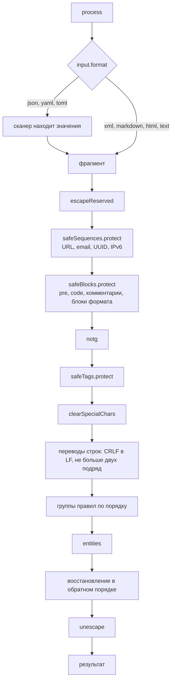

# Архитектура microtypo

Документ описывает, как движок устроен внутри: из каких модулей он состоит, через какие стадии проходит текст и какие инварианты держит каждая. Как подключать и настраивать движок, написано в [readme](../readme.md) и в [api/](../api/configuration.md).

## Граница

Движок — чистое преобразование: строка и конфиг на входе, строка на выходе. Внешних эффектов у него два: часы (`performance.now()` для бюджета времени) и `crypto.getRandomValues()` для nonce заполнителей. Файлы, stdin и stdout есть только у CLI. Зависимостей нет, один и тот же `src/` работает в Node.js и в браузере.

## Модули

| Путь                                           | Отвечает за                                                                            |
| ---------------------------------------------- | -------------------------------------------------------------------------------------- |
| `src/index.js`                                 | публичный вход: `microtypo()`, `MicroTypo`, `VERSION`, `DEFAULT_MAX_INPUT_LENGTH`      |
| `src/engine.js`                                | класс `MicroTypo`: конфиг, порядок групп, конвейер `process()`                         |
| `src/core/options.js`, `src/schemas/config.js` | разбор и проверка конфига, наборы правил, селекторы                                    |
| `src/input/`                                   | сканеры форматов: Markdown, JSON, XML, YAML, TOML, front-matter, шаблонные разделители |
| `src/protect/`                                 | хранилища: что прячется от правил за заполнителями и как возвращается                  |
| `src/rules/`                                   | двенадцать встроенных групп правил, `registry.js` задаёт их порядок                    |
| `src/rule-runner.js`, `src/define-rule.js`     | компиляция и запуск групп, включая пользовательские                                    |
| `src/errors/`                                  | типизированные ошибки с `code` и `details`                                             |
| `src/lib/`                                     | общие таблицы и утилиты: глифы, границы слов, diff для `changes`                       |
| `src/cli/`                                     | фильтр stdin → stdout поверх публичного API                                            |
| `src/browser.js`, `scripts/build-browser.mjs`  | один ES-модуль `dist/microtypo.browser.js` для страницы                                |

## Конвейер

`process(text, options)` проверяет тип и длину входа, запрещает повторный вход на том же экземпляре и выбирает разбор по `input.format`. В структурных форматах (JSON, YAML, TOML) сканер находит строковые значения, и каждое типографируется отдельно. XML, Markdown, HTML и обычный текст идут в конвейер целиком: XML после `validateXml` и без пробелов по краям, HTML и текст без ведущего отступа первой строки, который вклеивается обратно. У front-matter заголовок разбирается как YAML или TOML, а тело — как Markdown.

`escapeReserved` и `unescape` выполняются, только если во входе могут быть зарезервированные символы. Для HTML и текста вокруг групп правил работают ещё `liftIndents` и `settleIndents`, которые держат отступы строк. Между стадиями вызывается `checkBudget`. Восстановление идёт в обратном порядке: строчные блоки, абзацы, теги, затем `unwrapBlocks` (при `html: true`), обрезка краёв, блоки, последовательности. Сущности кодируются до восстановления, поэтому спрятанный текст автора не перекодируется. `changes` считается после прохода: `src/lib/diff.js` сравнивает вход с результатом.

## Защита разметки

Правила работают с текстом, в котором всё, что им трогать нельзя, заменено заполнителями.

- Заполнители хранилищ тегов и блоков строятся из четырёх зарезервированных символов PUA. Если они встречаются во входе, `escapeReserved` на время прохода подменяет их свободными символами PUA, поэтому вход не может подделать заполнитель.
- Заполнители URL, адресов и токенов написаны ASCII и несут nonce из CSPRNG, новый на каждый `process()`. Восстановление сверяет nonce, а неизвестный id оставляет как есть, а не стирает.
- Каждое хранилище ограничено `MAX_ENTRIES` записей на вызов.
- Пользовательская группа получает суженный `ctx` без ссылки на движок. `TokenBudget` из `protect/forgery.js` считает заполнители: группа может вернуть столько вхождений каждого, сколько получила, плюс выданные ей движком, а лишние считаются подделкой и вычищаются. Встроенным группам движок доверяет.

## Правила

Порядок встроенных групп задаёт `DEFAULT_GROUPS` в `src/rules/registry.js`. Группа компилируется один раз, при создании экземпляра или при `registerRuleGroup`. Определение группы замораживается снимком, так что изменение объекта после регистрации не меняет вывод. Сами правила здесь не описываются: их поведение задают тесты и корпус соответствия, справочник — [api/rules-reference.md](../api/rules-reference.md), пользовательские группы — [api/extending.md](../api/extending.md).

## Пределы

`maxInputLength` отсекает вход до обработки, `maxProcessingMs` проверяется между стадиями и внутри долгих сканеров, сканеры с риском нелинейного перебора ограничивают его на каждую попытку и при переполнении отказывают. Значения и модель угроз описаны в [api/security.md](../api/security.md).

## Поставка

Пакет `microtypo` экспортирует `.`, `./define-rule`, `./errors` из `src/` и `./browser` из `dist/`. Браузерный модуль собирает rolldown на `prepack`: один читаемый файл без импортов и комментариев. CLI `microtypo` — `src/cli/index.js`.

## Корпус соответствия

`test/conformance/corpus.jsonl` записывает поведение движка как данные, чтобы другие реализации, например [microtypo.rs](https://github.com/meritt/microtypo.rs), сверялись с ним байт в байт. `node test/conformance/build.mjs` собирает его из двух источников: вызовов `process()`, которые делает набор тестов, и сгенерированных с фиксированным seed комбинаций документов и опций. Каждый случай выполняется дважды; случай с разными результатами или упёршийся в бюджет времени в корпус не попадает. `test/conformance/corpus.test.js` падает, пока изменение поведения не записано в корпус.
